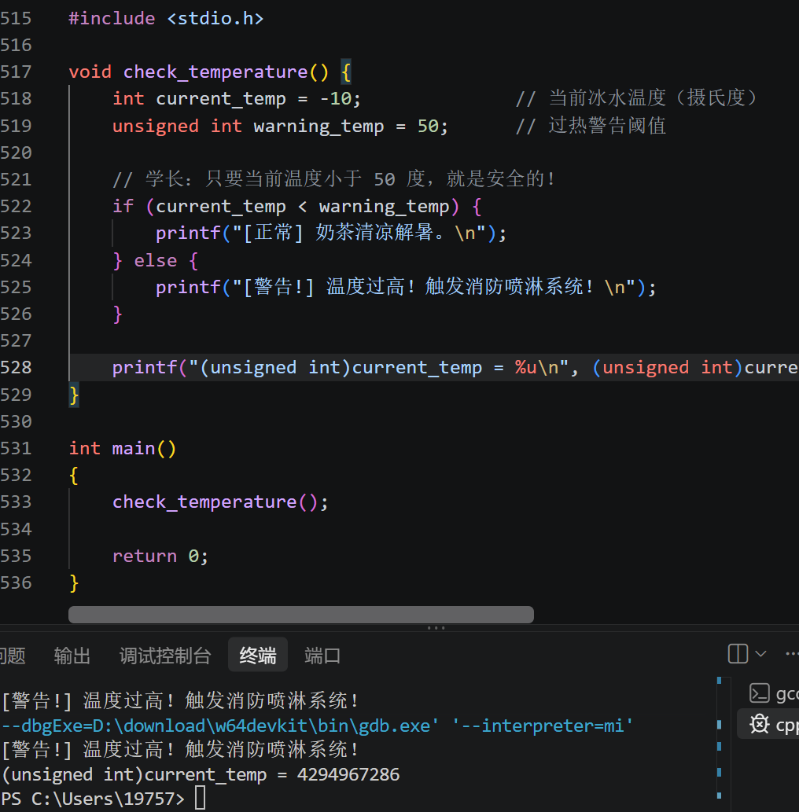

# 前言

这一章的主题是整数和浮点数在机器里到底怎么存。整数部分（补码、溢出、移位）在 MEDIUM-1 里接触过一点；浮点数基本是全新的。

md 的排版框架用了 AI 协助，里面的每一步推导我都重新推过。
感觉本题算是《深入理解计算机系统》第二章浮点数相关内容的一个引子。

不愧是倪蔻学长，虾钳一挥，又是一篇神秘小故事。

---

# MEDIUM-2：计算机中的整数与浮点数

## Step1：甜度与温控传感器 —— 补码与类型隐式转换

### 任务 1.1：到底有多甜？

**题目理解**

寄存器里躺着一串二进制 `1001 1100`。这串 0 和 1 本身没有任何含义，关键看用什么规则去读它：按无符号数读是一套结果，按有符号补码读是另一套结果。

#### 1. 按无符号整数解析

无符号数里每一位都是"正权重"，直接按权展开：

128 + 0 + 0 + 16 + 8 + 4 + 0 + 0 = **156**

#### 2. 按有符号补码整数解析

最高位是 1，说明这是个负数。两种办法求它的真值：

办法一：对补码再做一次"取反加一"，得到它的绝对值：（学院派）

```
1001 1100（补码）
取反：0110 0011
加一：0110 0100 = 64 + 32 + 4 = 100
所以真值是 -100
```

办法二：先按无符号展开得到 156，再减去 2⁸ = 256：（偷懒派）

156 − 256 = **−100** 
其实该方法本质是基于 B2T 公式：B2T_w(x) = −x_{w−1}·2^{w−1} + Σ x_i·2^i，即 "最高位是负权，其余位正权"：

```
1001 1100 = −2⁷ + 16 + 8 + 4 = −128 + 28 = −100
```


#### 3. 为什么底层清一色用补码，而不是原码或反码？

先把三种编码对比一下（8 位）：

| 编码 | 正数怎么表示 | 负数怎么表示 | 0 的个数 | 范围 |
|---|---|---|---|---|
| 原码 | 最高位放 0，其余放绝对值 | 最高位放 1，其余放绝对值 | 两个（0000 0000 和 1000 0000） | −127 ~ 127 |
| 反码 | 同原码 | 对应正数按位取反 | 两个（0000 0000 和 1111 1111） | −127 ~ 127 |
| 补码 | 就是本身 | 对应正数取反再加一 | 一个 | −128 ~ 127 |

补码的好处有三条：

**① 减法直接变加法，硬件只需要一个加法器。**

原码做减法很麻烦：得先看两个数谁的绝对值大，再决定结果符号和谁减谁。

补码直接把减一个数变成加它的负数补码，符号位也一起参与运算，超出 8 位的进位直接丢掉。比如 3 − 5：

```
  0000 0011        （+3）
+ 1111 1011        （-5 的补码）
-----------
  1111 1110        （-2 的补码，最高位的进位丢掉）
```

（做硬件的时候）加法器一套电路就把加减全包了，不需要专门的减法器。

**② 0 只有一种表示。**（所以补码是双射）

原码和反码都有"+0"、"−0"两个零，既浪费一个编码，做相等判断时还要特判。补码里 0 只有 `0000 0000` 一种表达。

**③ 表示范围多出一个负数。**

原码（中心对称）、反码（轴对称）都是对称的 −127 ~ 127，补码把省下的那个重复编码给了 `1000 0000`，表示 −128，范围变成 −128 ~ 127。

补码为什么能"取反加一"？本质上它是一个**模 2⁸ 的环**：8 位寄存器存不下超过 255 的数，天然对 256 取模。那么 −1 和 255 在环上是同一个位置，所以 −1 就直接编码成 255（`1111 1111`）。"取反加一"只是快速求"256 减去绝对值"的手段。前面那个"无符号值减 256"的快捷算法也是这个道理：补码的位模式本来就等于真值加上 256。
据说因为几乎所有主流硬件都用补码，C23 标准干脆把补码定为唯一选择。

**易错点**

- 读补码负数注意不能直接按权展开，最高位的权重不是 +128，要先取反加一，或者整体减 2ⁿ。
- 反码的"−0"是 1111 1111，原码的"−0"是 1000 0000，两个长得不一样，别记混。
- 补码的范围不对称（−128 没有对应的 +128）。 

---

### 任务 1.2：冰块引发的火灾警报

**题目理解**

一段代码里拿 `int` 类型的 −10 去和 `unsigned int` 类型的 50 比大小。直觉上 −10 < 50 天经地义，但 C 语言在比较之前会偷偷做一次类型转换，问题就出在这。

**思路**

C 的规则（"隐式强制类型转换）：有符号数和无符号数一起运算时，如果两边位数相同，**有符号数会被隐式转换成无符号数**，再按无符号比较。

`current_temp = -10` 被当成 unsigned 解释时，位模式不变，按无符号读出来就是：

2³² − 10 = **4294967286**

于是比较变成：

```
4294967286 < 50 ?  →  假
```

程序走进 else，输出的是：

```
[警告!] 温度过高！触发消防喷淋系统！
```

−10 度的冰水反而触发了消防喷淋。



**易错点**

- `%u` 才是打印 unsigned 的格式符，`%d` 打印 unsigned 大数会出问题。
- 修法：把比较的两项的类型统一，比如阈值也直接写成 `int warning_temp = 50;`，或者先显式强转 `(int)warning_temp` 后再比（注：强转只在确定值不会溢出 int 时才安全）。

---

## Step2：反物质珍珠 —— 整数溢出与二进制下的运算

### 任务 2.1：算术溢出的惨剧

**题目理解**

8 位有符号补码计数器只能表示 −128 ~ 127。88 + 65 = 153，装不下，寄存器里的位模式会"回绕"成一个负数，系统就以为老板欠了机器珍珠。

#### 1. 相加后寄存器里的位模式

```
  0101 1000     （88）
+ 0100 0001     （65）
-----------
  1001 1001
```

寄存器里实际保存的就是 **1001 1001**。

#### 2. 系统认为有多少颗？正溢出还是负溢出？

`1001 1001` 最高位是 1，按补码读成负数。取反加一：

```
取反：0110 0110
加一：0110 0111 = 64 + 32 + 4 + 2 + 1 = 103
```

系统认为杯子里有 **−103** 颗珍珠。

也可以用快捷算法：无符号值 153 − 256 = −103。

两个正数相加，结果却成了负数，这叫**正溢出**（超过最大值 127）。反过来，两个负数加出正数叫负溢出。位模式上的规律很直观：**两个加数符号相同，但结果符号和它们相反，就溢出了**；符号相同说明进位冲进了符号位，并把它反转。

#### 3. 补全 is_safe

题目骨架已经把三个符号位都提取好了：`x >> 31` 把符号位挪到最低位，再 `& 1` 取出来（0 正 1 负）。那判断条件直接照上面的规律写：

- x 和 y 同号，且结果符号和它们不同 → 溢出，返回 0；
- 其余情况（异号相加永远不会溢出，或者同号结果符号没变）→ 安全，返回 1。

**代码**

注：题目骨架里有**两处软脚**，声明 `int rusult;`注释也写成了 `END OD TO DO`。

```c
/* 若相加不发生溢出返回 1，发生溢出返回 0 */
int is_safe(int x, int y)
{
    int sum = x + y;

    int x_sign = (x >> 31) & 1;     /* 提取 x 的符号位：0 正，1 负 */
    int y_sign = (y >> 31) & 1;     /* 提取 y 的符号位 */
    int sum_sign = (sum >> 31) & 1; /* 提取结果的符号位 */

    int result;

    //TO DO
    if (x_sign == y_sign && sum_sign != x_sign)
        result = 0;   /* 同号相加、结果却变了号 -> 溢出 */
    else
        result = 1;   /* 异号相加不会溢出；同号但结果没变号也安全 */
    //END OF TO DO

    return result;
}
```

更严谨的版本（加之前就判断，完全避免溢出的发生）（**据说**是真实工程里的写法）

```c
#include <limits.h>

int is_safe(int x, int y)
{
    /* 两个正数相加：只要 y 超过 INT_MAX - x 就溢出 */
    if (x > 0 && y > 0 && y > INT_MAX - x)
        return 0;

    /* 两个负数相加：只要 y 小于 INT_MIN - x 就溢出 */
    if (x < 0 && y < 0 && y < INT_MIN - x)
        return 0;

    return 1;
}
```

---

### 任务 2.2：没有乘法器的悲哀（据说叫强度削减）

**题目理解**

把奶量 x 乘以 29，只准用左移 `<<`、加法 `+`、减法 `-`，运算符用得越少越好。左移一位就是乘 2，左移 n 位就是乘 2ⁿ，所以这题本质是把 29 拆成 2 的幂的组合。

**思路**

最朴素的拆法，把 29 写成二进制 `11101₂` = 16 + 8 + 4 + 1：

```c
y = (x << 4) + (x << 3) + (x << 2) + x;
```

数一下：3 个 `<<` + 3 个 `+` = **6 个运算符**。

换个方向，29 离 32 只差 3，而 32 是 2⁵：

```
29 = 32 − 3 = 32 − 2 − 1
```

所以：

```c
y = (x << 5) - (x << 1) - x;   /* 32x - 2x - x = 29x */
```

2 个 `<<` + 2 个 `-` = **4 个运算符**。

**代码**

```c
int final_milk(int x) {
    int y;

    //TO DO
    y = (x << 5) - (x << 1) - x;   /* 29 = 32 - 2 - 1 */
    //END OF TO DO

    return y;
}
```

**易错点**

- 移位的优先级比加减低，`(x << 5)` 的括号别省，写成 `x << 5 - x << 1` 会被解释成 `x << (5 - x) << 1`，完全不是一回事。

---

## Step3：丝滑配比阀 —— 认识 IEEE 754 标准下的浮点数

### 任务 3.1：对学长提示的深入理解

#### 1. float 和 double 各自的位数划分

| 类型 | 总位数 | 符号位 S | 阶码位 E(k) | 尾数位 M(n) |
|---|---|---|---|---|
| float（单精度） | 32 | 1 | 8 | 23 |
| double（双精度） | 64 | 1 | 11 | 52 |

符号位 0 正 1 负。尾数部分在规格化数里隐含一个整数位 1，因此获得了一个额外精度位，实际有效精度是 24 位和 53 位。

#### 2. 偏置 Bias 怎么算，为什么要加偏置

设阶码字段有 k 位，则：

Bias = 2^(k-1) - 1

- float：k = 8，Bias = 2⁷ − 1 = **127**
- double：k = 11，Bias = 2¹⁰ − 1 = **1023**

存储时不是直接存真实阶码，而是存 "真实阶码 + Bias"（这叫偏置表示 biased）。这个偏置值就是阶码字段里的无符号数，记作 e；读取时按 E = e − Bias 还原真实阶码。

这样做的意义：

- **阶码字段位表示的 e 没有负号（无符号数），比较大小省事。** 真实阶码 E 越大，字段的无符号值 e 也越大。对两个正数浮点数，直接把它们的位模式作为无符号整数从左往右比，就能比出大小。
- **阶码的正负范围大致对称。** 8 位字段能表示 0 ~ 255，去掉全 0（非规格化）和全 1（特殊值）两端，规格化阶码字段是 1 ~ 254，对应真实阶码 −126 ~ 127。

#### 3. 非规格化数的特点

阶码字段全为 0 时进入非规格化表示，它有三个特点：

1. **隐含的整数位变成 0**，尾数真值写成 `M = 0.f`，不是规格化数的 `1.f`(即 `M = 1 + f` 变成 `M = f` )；
2. **违反直觉地，真实阶码固定为 E = 1 − Bias**而不是 0 − Bias；
3. 它的作用是**填补 0 和最小规格化数之间的空当**，让很小的数能"逐渐地、等间距地"趋近 0（逐渐下溢），同时全 0 位模式自然表示 ±0。（±0的性质有同有不同）

没有非规格化数的话，比最小规格化数还小的数只能直接变成 0，数与数之间会突然断层。

#### 4. 两个特殊阶码模式（阶码全 1）

阶码全 1 留给特殊值：

| 阶码 | 尾数 | 含义 |
|---|---|---|
| 全 1 | 全 0 | 无穷大 ∞（符号位 0 是 +∞，1 是 −∞） |
| 全 1 | 非 0 | NaN（Not a Number，非数） |

∞ 用来表示"溢出了还有方向"的结果，比如正数除以 0 得到 +∞；NaN 表示"结果根本不是个数"，比如 0/0、∞ − ∞、对负数开根号。

**易错点**

- 阶码字段全 0 和全 1 都不参与普通数值的表示，所以规格化数的阶码字段是 1 ~ 254（float），别把 0 和 255 也算进去。
- 非规格化数的隐含位是 0；规格化数的隐含 1 不占存储位，非规格化数的 0 也不占。
- NaN 不等于任何数，连它自己都不等于，代码里不能用 `x == NaN` 判断 NaN（据说要用 `isnan()`才行）。

---

### 任务 3.2：补全浮点数对照表

**题目理解**

八位迷你浮点：`S EEEE MMM`，4 位阶码、Bias = 7、3 位尾数。

规则汇总：

- 阶码字段 `0001 ~ 1110`：规格化，e = E − 7，M = 1.f；
- 阶码字段 `0000`：非规格化，E = 1 − 7 = −6，M = 0.f；
- 阶码字段 `1111`：特殊值，尾数全 0 是 ∞，尾数非 0 是 NaN。

**思路（逐行算）**

#### 第二行：`0 0000 011`

阶码全 0，非规格化。

- **(A) 非规格化**
- **(B) e = 1 − Bias = 1 − 7 = −6**
- **(C) 尾数 f = 011，M = 0.011₂ = 0×1/2 + 1×1/4 + 1×1/8 = 3/8 = 0.375**
- **(D) 真值 = 3/8 × 2⁻⁶ = 3/512 ≈ 0.005859**

#### 第三行：`0 1111 000`

阶码全 1、尾数全 0。

- **(E) 特殊值：正无穷 +∞**

#### 第四行：`0 1001 010`

阶码字段 e = 1001₂ = 9，在 1 ~ 14 之间，规格化。

- **(F) e = 9 − 7 = 2**
- **(G) f = 010，M = 1.010₂ = 1 + 1/4 = 1.25**
- **(H) 真值 = 1.25 × 2² = 5.0**

**补全后的表**

| 二进制位模式 | 编码类型 | 实际阶码 e | 尾数真值 M | 十进制最终真值 |
|---|---|---|---|---|
| 0 0110 100 | 规格化 | 6 − 7 = −1 | 1.100₂ = 1.5 | 1.5 × 2⁻¹ = 0.75 |
| 0 0000 011 | **非规格化** | **−6** | **0.011₂ = 0.375** | **3/8 × 2⁻⁶ = 3/512 ≈ 0.005859** |
| 0 1111 000 | **特殊值（+∞）** | 不适用 | 不适用 | +∞（正无穷） |
| 0 1001 010 | 规格化 | **9 − 7 = 2** | **1.010₂ = 1.25** | **1.25 × 2² = 5.0** |

### 任务 3.3：阀门的极限

把这个八位格式的表示边界全列一遍：最小/最大正非规格化数、最小/最大正规格化数。最后解释非规格化数的阶码为什么是 1 − Bias 而不是 −Bias。

#### 1. 正非规格化数的边界

非规格化：阶码全 0，尾数只有 3 位小数在变。

**最小的正非规格化数**：尾数只有最低位是 1。

- 位模式：`0 0000 001` = **0000 0001**
- M = 0.001₂ = 1/8，e = −6
- 真值 = 1/8 × 2⁻⁶ = 2⁻⁹ = **1/512 ≈ 0.001953**

**最大的正非规格化数**：尾数三位全 1。

- 位模式：`0 0000 111`
- M = 0.111₂ = 7/8，e = −6
- 真值 = 7/8 × 2⁻⁶ = **7/512 ≈ 0.013672**

#### 2. 正规格化数的边界

规格化：阶码字段范围 0001 ~ 1110，对应 e 从 −6 到 7。

**最小的正规格化数**：阶码字段最小（0001），尾数全 0。

- 位模式：`0 0001 000` 
- M = 1.000₂ = 1，e = −6
- 真值 = 1 × 2⁻⁶ = **1/64 = 8/512 ≈ 0.015625**

**最大的正规格化数**：阶码字段最大（1110），尾数全 1。

- 位模式：`0 1110 111` 
- M = 1.111₂ = 1 + 7/8 = 15/8，e = 7
- 真值 = 15/8 × 2⁷ = 15/8 × 128 = **240**

#### 3. 非规格化数的阶码为什么是 1 − Bias？

把这两个边界数放在一起看：

最大正非规格化：7/512
最小正规格化：   8/512
两者间隔：          1/512

非规格化数内部，相邻两个数的间距是多少？尾数最低位变化 1，真值变化 1/8 × 2⁻⁶ = 1/512。所以非规格化数是以 1/512 为步长均匀排开的，而它和最小规格化数之间的间隔**恰好也是 1/512**，整条数轴平滑接上，没有断层。

假设非规格化数用 e = −Bias = −7 会怎样？

- 最大非规格化数变成 7/8 × 2⁻⁷ = 7/1024；
- 最小规格化数还是 2⁻⁶ = 16/1024；
- 两者间隔 9/1024，差不多是正常步长（1/1024）的 9 倍，这里会突然断层。

让非规格化数沿用最小规格化数的阶码（−6），而尾数隐含位从 1 退化成 0，相当于让尾数从 1.0 **平滑**地"缩"到 0.111、0.110……一直到 0，步长始终一致。这就是**逐渐下溢的设计意图**。

**易错点**

- 最小规格化和最大非规格化的阶码都是 −6，但是阶码的算法不一样，区别是在隐含位是 1 还是 0。

---

## Step4：消失的营业额 —— 浮点加法、舍入与结合律

### 任务 4.1：设计加法程序

**题目理解**

输入两个八位迷你浮点（只考虑非负的规格化数，不考虑非规格化、负数、特殊值），模拟浮点加法的前三步——**对阶、尾数运算、规格化**，输出规格化后的二进制。不考虑溢出，移位丢掉的位直接丢弃（向零舍入）。

题目还留了一个思考题：对阶为什么是"小阶向大阶看齐"。

#### 对阶为什么让小阶向大阶看齐？

对阶要把两个数的阶码弄成一样，然后尾数才能相加减。两种做法：

- **大阶向小阶看齐**：大的那个尾数要**左移**，阶码减小。左移会把整数位和高位的 1 挤出去，丢掉的是一个数里最重要的高位，误差巨大，而且可能直接破坏规格化形式；
- **小阶向大阶看齐**：小的那个尾数**右移**，丢掉的只是它末尾的低位。本来小的数对结果的贡献就小，舍它的低位，整体误差最小。

所以一律让小阶向大阶看齐，即小阶尾数右移。

**思路**

1. **对阶**：谁的阶码小，就把谁的尾数右移直到两者阶码相等；
2. **尾数运算**：两个整数尾数直接加；
3. **规格化**：两个 `1.xxx` 相加，结果最多是 `11.xxx`，只可能需要右规一位（整数部分进位了就右移一位、阶码加一）。因为输入都是规格化数，大的那个尾数整数位的 1 始终在，加完不会小于 1.0，所以不需要左规。实际上一定是 10.xxx / 11.xxx 中的一种，一定需要右规一位（按**本题只考虑非负的规格化数，忽略非规格化数和其它特殊情况**）（不过下面代码写的是一般情况也适用的版本，即会判断是否需要右规）；
4. **舍入处理**：采取向零舍入，而向零舍入正好就是 C 里无符号整数的右移（`>>`），移出的位直接扔掉。
5. **溢出判断**：不考虑溢出。

**代码** 

```c
#include <stdio.h>

/* 把 8 位二进制字符串转成整数 */
int parse8(const char *s) 
{
    int v = 0;
    for (int i = 0; i < 8; i++)   
    {                             /* 把字符变成数字: */
        v = v * 2 + (s[i] - '0'); /* 两个字符做减法，本质是拿它们的 ASCII 码做减法，*/        
    }                             /* 连续排列保证了结果恰好是想要的数字。 */
    return v;
}

/* 按 8 位二进制打印 */
void print8(int v) 
{
    for (int i = 7; i >= 0; i--)  // 最高位到最低位，一位一位打出来
    {
        putchar((char)('0' + ((v >> i) & 1))); // 把第 i 位抠出来，得到数字 0 或 1
    }
}

/* 八位迷你浮点加法：只支持非负规格化数 */
int mini_add(int a, int b) 
{
    int ea = (a >> 3) & 0xF;          /* 取 4 位阶码字段 */
    int eb = (b >> 3) & 0xF;
    int ma = (a & 0x7) | 0x8;         /* 取 3 位尾数，补上隐含位 1 */
    int mb = (b & 0x7) | 0x8;

    /* 第一步：对阶，小阶向大阶看齐，右移即向零舍入 */
    while (ea < eb) 
    { 
        ma >>= 1; 
        ea++;
    }
    while (eb < ea)
    { 
        mb >>= 1; 
        eb++; 
    }

    /* 第二步：尾数相加 */
    int m = ma + mb;
    int e = ea;

    /* 第三步：规格化，出现 10.xxx / 11.xxx 时右规一位 */
    if (m & 0x10)
    {
        m >>= 1;
        e++;
    }

    return (e << 3) | (m & 0x7);      /* 阶码归位，尾数只留低 3 位 */
}

int main(void) 
{
    char s1[9], s2[9];
    while (scanf("%8s %8s", s1, s2) == 2)  // %8s：最多读 8 个字符；scanf 的返回值：成功读到的项数
    {
        print8(mini_add(parse8(s1), parse8(s2)));
        putchar('\n');
    }
    return 0;
}
```

**手工过一遍`示例 1`：`01001011 + 01001100`**

```
01001011 = 0 1001 011，e = 9-7 = 2，尾数 1.011
01001100 = 0 1001 100，e = 9-7 = 2，尾数 1.100

阶码相同，不用对阶。

尾数相加：
  1.011
+ 1.100
--------
 10.111        （整数部分进位，需要右规）

右规一位：1.011|1，e 加一变成 3，向零舍入丢掉移出的 1，尾数取 011

结果：0 1010 011 = 01010011
```

**运行示例**

```
输入：
01001011 01001100
01000110 01001101
01001000 01000111
01000111 01000101

输出：
01010011
01010010
01001111
01001110
```

和题目给的四组输出全部一致。我还试了一组阶差很大的 `01110111 + 00010001`（240 加一个很小的数），输出仍是 `01110111`，小的数右移 12 位后整个变成 0，被大数吃掉了——这正是 4.2 要讲的现象。

**易错点**

- 一定要把隐含的 1 补上再运算：`(a & 0x7) | 0x8`。我一开始搞忘了，只用了 3 位尾数加，结果进位关系全乱。
- 右规最多一位，别写成循环；但**对阶的移位次数是循环**，阶差几位就移几次。
- 向零舍入就是整数右移，丢掉的位不再看；如果题目要求"0 舍 1 入"（就近舍入），移出的高位是 1 时还得加回来，要注意。
- 拼结果时尾数记得 `& 0x7`，右规后整数位不能带进输出。
- 阶码相加后可能溢出到 1111，题目明确说不考虑，不然还得处理成 ∞。

---

### 任务 4.2：老板为什么每天都在亏钱？

同样三个数，`(a + b) + c` 和 `a + (b + c)` 算出来不一样，一个 15 一个 0。要从浮点加法的对阶、舍入角度解释为什么结合律失效。

先看算法 1：

```
(1e20 + (-1e20)) + 15
= 0 + 15
= 15
```

两个数绝对值相同、符号相反，精确抵消，15 保住了。

再看算法 2，先算括号里的 `-1e20 + 15`：

- 1e20 大约是 2⁶⁶ 量级，15 大约是 2⁴ 量级，**阶码相差约 62**；
- 对阶时 15 的尾数要右移约 62 位才能对齐；
- float 的尾数连隐含位只有 24 位，右移 62 位后，15 的所有位都被移了出去，尾数变成 0（舍入）；
- 于是 `-1e20 + 15 = -1e20`，15 凭空蒸发；
- 再算 `1e20 + (-1e20) = 0`，最终 revenue2 是 0。

这就是"**大数吃小数**"：两个数量级相差太悬殊的数相加，小的数在对阶阶段就被舍没了。

数学上的实数加法满足结合律，因为实数是无限精度的。但浮点加法每做一次都要舍入一次，**舍入发生在哪一步取决于加法顺序**，先加的两个数先被舍一次，所以括号位置不同，结果就不同。浮点加法满足交换律（a+b 和 b+a 完全同一步），但不满足结合律。

float 只有约 7 位十进制有效数字，1e20 后面跟着的 15 远远落在第 20 位之后，本来就不在它能分辨的范围里。

**易错点**

- 不能用 `==` 判断运算后的浮点数的结果是否等于另一个值，尤其累加过程里应该用 `fabs(a - b) < eps`（设一个误差上限）。
- 累加大量小数时，把小的数先加（或者按量级排序后加），能减轻大数吃小数；这也是对阶规则决定的——先加小的，它们能先凑成一个大到不被吃掉的数。

---

## 学习小结

1. **有符号和无符号混在一起运算，有符号会被隐式转成无符号**，`-10 < 50（u）` 会变成假。
2. **溢出的判断信号**：同号相加、结果变号。两个正数加出负数（88+65 变成 −103）是正溢出，反之为负溢出。
3. **乘法可以用移位和加减代替**；注意移位加括号。
4. **IEEE 754 = 符号位 + 阶码（加 Bias）+ 尾数（规格化隐含 1）**。float 1/8/23，double 1/11/52。阶码全 0 是非规格化（隐含 0，E = 1−Bias），全 1 是 ∞ 和 NaN。
5. **非规格化数让数轴平滑地趋近 0**：它和最小规格化数同阶码，靠隐含位从 1 退成 0，保持相邻数间距不变。
6. **浮点加法三步走：对阶（小阶向大阶看齐，舍小的尾数）→ 尾数加 → 规格化**。八位迷你格式里右规最多一位，向零舍入就是整数右移。既然对阶一定会损失精度，那就抓大放小。
7. **浮点加法不满足结合律**，因为每一步都在舍入，顺序不同舍掉的东西不同；数量级相差超过尾数位数，大数直接吃小数。涉及钱的计算，用整数。